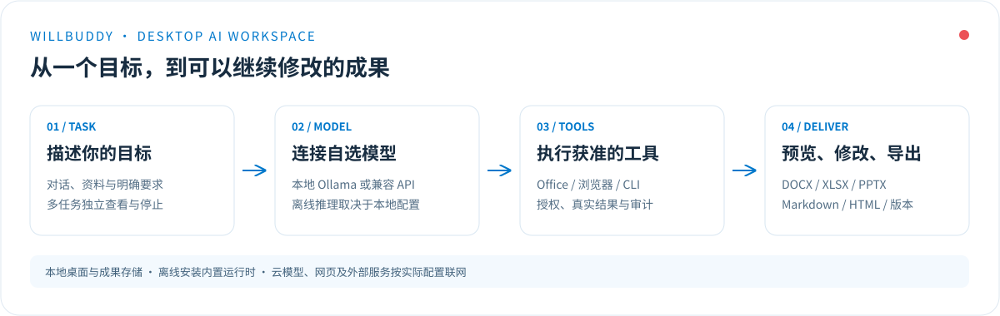
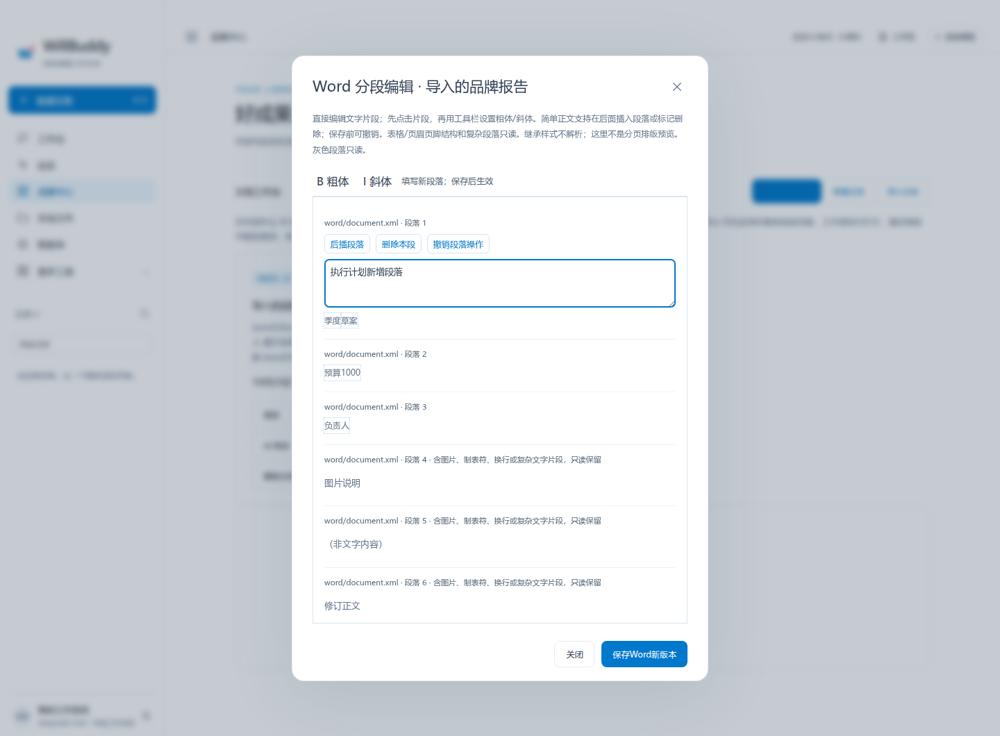

0.19.0：Excel预览图片按单格/双格/绝对锚点定位，跟随对应工作表与可见网格；不再把整个工作簿图片堆在表尾。保持离线内置，无需另装软件。见[范围与验收](docs/SPREADSHEET_IMAGES.md)。

0.18.0：同一Office文档版本的预览在后台刷新/侧栏调整时保持连接，不重新读文件/解析，保留Excel工作表选择和滚动；关闭、换文档或版本后释放重载。无需新增软件。见[说明](docs/PREVIEW_LIFECYCLE.md)。

0.17.0：修复安装包内Office预览组件无法加载/超时，新增本地文件和ASAR原生Electron验收、阶段错误与重新加载。无需安装额外软件。见[修复与范围](docs/PREVIEW_TIMEOUT_FIX.md)。

0.16.0：Office「预览」内置离线页面/表格/幻灯片渲染，移除外部GenOffice按钮，不用另装软件。复杂排版/图表兼容范围见[预览说明](docs/OFFICE_PREVIEW.md)。

<div align="center">
  
  <h1>WillBuddy · 离线桌面 AI 工作台</h1>
  <p><strong>让 AI 帮你处理文档、操作浏览器、执行命令，并交付可以继续修改的成果。</strong></p>
  <p>公开源码 · Apple Silicon · 本地工作空间 · 自选模型 · Office 文档 · 多任务</p>
  <p><a href="#功能一览">功能介绍</a> · <a href="#安装与开始使用">安装</a> · <a href="#配置你的模型">模型配置</a> · <a href="#常见问题">常见问题</a> · <a href="#开发与源码构建">开发</a> · <a href="#english-overview">English</a></p>
</div>

**WillBuddy 是一款源码公开、支持离线安装的桌面 AI 工具。** 它把模型对话、Word / Excel / PowerPoint 文档、Markdown / HTML、浏览器自动化和 CLI 命令放在同一个工作台中，适合个人办公、资料整理、报告撰写和开发辅助。

应用包内置 Electron、Chromium、Node 和基础 Office 文档编解码器，安装时无需再执行 `npm install`。**离线安装不等于所有 AI 功能都能断网运行**：使用云模型、访问网页需要联网；纯离线推理需要自行准备本地模型及运行环境。目前只制作 Apple 芯片（arm64）Mac 应用。

> 本文介绍已交付的桌面 **0.19.0**，对应代码在 [`willbuddy-v0.19.0-spreadsheet-images`](https://github.com/scliubingxin/WillBuddy/tree/willbuddy-v0.19.0-spreadsheet-images) 分支；`main` 尚未合入该版本，开发时请先切换分支。处于持续开发阶段；已提供的离线包为 ad-hoc 签名候选版，尚未完成 Apple Developer ID 签名、公证及 Mac 原生完整验收。仓库已公开源码，许可证状态见[许可与项目定位](#许可与项目定位)。



## 界面预览

### 对话、执行与成果，在同一工作空间

流式输出、Markdown 表格与列表、右侧成果预览、原文查看和继续修改，让对话能够逐步形成实际交付。


*当前生产界面截图，使用明确标注的演示数据与模拟原生桥；不是一次真实模型任务的运行证明。*

### 文档工作台：生成之后，还能继续改

在成果中心管理 Word、Excel、PowerPoint、Markdown 和 HTML。支持导入、AI 修改、直接编辑内容、历史版本和真实文件导出；导入原件保持不变。


*截图中的示例文档由项目实际编解码器生成；界面与数据用于功能展示。旧截图展示0.11界面；0.16已新增内置静态渲染，复杂Office排版仍可能有兼容差异。*

**0.14.0 新增本地 Excel 公式编辑与重算**：修改数量后，合计与跨工作表引用会重新计算；支持 SUM、AVERAGE、MIN、MAX、COUNT、IF、ROUND，以及基础运算和 A1 引用。可以切换工作表、只看公式、增加单元格，并导出包含公式及新缓存值的真实 XLSX。


*生产 Chromium 页面和真实 XLSX，合成预算数据、模拟原生桥与审批；8 个公式结果与容器 LibreOffice 重算一致，不是 Excel 全兼容或 Mac 真机验收。详见[公式范围与使用说明](docs/SPREADSHEET_FORMULAS.md)。*

**0.15.0 新增导入 Word 的段落增删**：在简单正文段落后插入内容，或标记删除本段，保存前可以撤销。AI也可读取段落坐标后完成增删；保留原件、历史版本、未修改部件及既有Word/Excel能力。



*生产 Chromium 界面、真实DOCX与合成数据，原生桥和审批仍为测试适配器。表格/页眉页脚仅保留原片段编辑，复杂段落及带样式引用/编号/分节属性结构只读；不是分页保真编辑器。见[段落编辑说明](docs/WORD_PARAGRAPHS.md)。*

## 功能一览

| 能力 | 你可以做什么 | 当前范围 |
| --- | --- | --- |
| AI 对话 | 连接自选模型，流式接收回答，查看 Markdown 与静态 HTML | Chat Completions 兼容接口；工具能力取决于模型支持 |
| Word 文档 | 内部富文本画布、标题/粗体/列表/表格，Markdown/HTML转Word | 真实GenOffice子引擎；导入DOCX可按片段改字/粗体/斜体；复杂段落只读，分页显示有兼容差异 |
| Excel 表格 | 创建多工作表，编辑预算、常量与显式公式 | XLSX；七个基础函数、跨表 A1 引用、即时预览与保存重算；复杂公式/图表工作簿拒绝修改 |
| PowerPoint | 生成标题、项目符号和演讲备注，修改幻灯片文字 | PPTX；基础排版，非完整模板编辑器 |
| Markdown / HTML | 创建、整篇原文编辑、预览和导出原文 | HTML 预览隔离运行，禁止脚本与远程资源 |
| 浏览器工具 | 打开网页、读取正文、检查元素、点击和填写 | 内置浏览器 DOM 操作；快照失效后重新检查 |
| CLI 命令 | 调用本机程序，查看实际输出、退出码和执行记录 | 非交互进程；需要对应程序已安装 |
| 多任务 | 同时处理两项模型任务，切换草稿，独立停止，更多任务排队 | 与 CLI 共享两个名额；尚无模型自主并行子任务组 |
| 本地文件与记忆 | 授权文件夹、查找文本文件、附加资料、自定义偏好与智能体 | 本地授权与存储；尚无完整语义索引或云同步 |
| 版本与恢复 | 保留文档前五版，查看任务状态；重启后暂停旧请求 | 不自动重放已审批的外部操作，不续跑旧进程 |

回复下的文件卡片提供 **下载 DOCX / XLSX / PPTX**。工作区导出也跟随真实文件；“导出对话 Markdown”只保存聊天记录，不会冒充 Office 文件。


*真实生产编辑表单，演示数据；这是内容编辑器，不是 Word 保真页面编辑器。*

**0.12.0 已内置 GenOffice HTML→DOCX 子引擎**：点击“写 Word 文档”，在内部画布设置标题、粗体、列表、基础表格并保存真实 Word；Markdown/HTML 可离线转换为 Word，无需另装 GenOffice 或 npm。


*生产界面与真实 GenOffice 引擎验收截图，使用合成数据和模拟原生审批；不是 Mac 真机或付费模型运行证明。*

**0.13.0 新增导入 Word 的片段编辑**：直接修改正文、表格内文字及页眉页脚，设置片段粗体/斜体，保留既有其他格式和未修改文件部件。复杂段落只读保护，原件不覆盖，保存真实新版本。


*生产页面与真实DOCX，合成资料及模拟原生审批；不是分页预览或Mac运行证明。详见[导入Word编辑与边界](docs/IMPORTED_WORD_EDITING.md)。*

完整 GenOffice 套件尚未内嵌；预览已随应用提供，无需外部应用。复杂文件会显示兼容性提示，任意导入 DOCX 的保真编辑仍未完成。详见[内置预览](docs/OFFICE_PREVIEW.md)与[引擎边界](docs/GENOFFICE_ENGINE.md)。

详细操作：[文档工作台](docs/OFFICE_WORKSPACE.md) · [浏览器授权与弹窗](docs/APPROVAL_FIX.md) · [CLI 持久队列](docs/DURABLE_COMMANDS.md) · [共享任务调度](docs/SHARED_RUNS.md)。

## 安装与开始使用

### Apple Silicon Mac 离线应用

适用平台：**Apple 芯片 Mac / arm64，最低 macOS 12**。当前不提供 Intel Mac 安装包。

1. 获取实际交付的 `WillBuddy-v0.19.0-mac-arm64-offline.zip`。公开安装包是否已发布，请以仓库 [Releases](https://github.com/scliubingxin/WillBuddy/releases) 的实际内容为准；源码分支本身不是安装包。
2. 先把 ZIP 完整解压到“下载”等用户目录，保留 `.app` 内的符号链接；不要直接向 `/Applications` 解压。
3. 将 `WillBuddy.app` 移入“应用程序”；也可使用包内安装脚本安装到个人 `Applications` 目录。脚本会执行原生签名检查。
4. 打开应用，在左下角配置模型，然后新建一个任务。

离线应用已包含运行时，**最终用户无需安装 npm 或开发工具**。当前候选包未公证；遇到系统阻拦时按 macOS 正常安全流程处理，不关闭 Gatekeeper、不移除隔离标记。若原生签名检查失败，应停止安装并报告问题。

安装细节与故障说明：[桌面开发与安装](desktop/README.md) · [离线包签名与残留问题](docs/PACKAGING_INCIDENT.md)。

## 配置你的模型

WillBuddy 不内置付费模型账户，也不要求使用特定云厂商。

| 使用方式 | 配置内容 | 网络与依赖 |
| --- | --- | --- |
| 云端兼容 API | Base URL、模型 ID、自己的 API Key | 需要联网；费用与配额由服务商决定 |
| 本地 Ollama 等兼容服务 | 例如 `http://127.0.0.1:11434/v1`，以及已安装的模型 ID | 需提前自行安装运行环境、下载模型并启动服务 |

- 远程模型接口使用 HTTPS；本机回环地址可使用 HTTP。
- 要让 AI 调用文档、浏览器或 CLI，需开启工具模式，且所选模型支持标准 `tools` / `tool_calls`。
- 只有本地模型、资料和所需工具都已就绪，且任务不依赖网页或远程服务时，才可能完整离线执行；当前未完成各本地模型的真实离线验收。
- API Key 可在系统加密存储可用时加密保存；也可只在本次运行中使用。
- Git、Codex CLI、Python、Ollama 和外部 Office 工具链是可选程序，不包含在主程序离线包中。

## 从这几个任务开始

**生成 Word 方案**

> 创建一份 Word 项目方案，包含目标、执行步骤、风险与验收表。生成文件后，说明文档名称和版本。

**修改现有文档**

> 在成果中心导入 DOCX 后，点击“AI 修改”：将标题中的“草案”改为“正式版”，保留原件并保存新版本。

**创建 Excel 任务表**

> 创建一个 Excel 工作簿，包含任务名称、负责人、预算和完成状态，分成“计划”和“预算”两张工作表。

**整理网页资料**

> 打开指定网站，读取页面内容并整理摘要。只根据实际读取结果回答，区分原文与推断。

**并行处理工作**

> 第一个任务开始后，点击“新建任务”处理第二项工作。两项独立显示状态、保留草稿和停止；不需要等待第一个任务完成。

**带公式的预算表**

> 创建 Excel 预算，单价和数量用数字，金额使用显式公式对象，合计用 SUM；修改数量后重算并保存新版本。支持范围内的公式才允许修改，不要返回过期缓存。

这些是使用示例，不是固定回复或已经完成的业务结果。实际文件应出现在成果中心，浏览器与 CLI 操作应有执行记录。

## 本地、权限与数据

- **本地工作空间**：对话、文档、任务和审计保存在本机；当前没有云同步。文档与对话并非整体加密保险箱。
- **模型数据流**：请求内容发送到你配置的模型服务；本地存储不代表资料从不离开设备。
- **文件授权**：按用户选择授权目录。CLI 以当前系统账号权限运行，工作目录不是操作系统沙箱。
- **浏览器确认**：首次可选择“本任务本站点允许”，后续同任务、同站点不反复弹窗；跨站、新任务重新确认，工具页可撤销。
- **可取消确认框**：Esc 取消；菜单提供 `⌘⇧Esc` / `Ctrl+Shift+Esc` 紧急取消入口，60 秒未确认自动取消。Mac 原生行为仍待实机验收。
- **文档版本**：导入原件不写回，保留前五版；修改冲突时要求重新读取和审批。

为兼容历史配置和系统密钥，内部可能保留 `Actwill AI`、`actwill-desktop` 等身份。不要仅为改名删除旧数据目录。详见[架构说明](docs/ARCHITECTURE.md)。

## 常见问题

### 不联网也能用 AI 吗？

应用可以离线安装，本地成果可以离线查看和处理。AI 推理需要模型：配置云模型就需要联网；配置并准备好本地兼容模型后，可处理不依赖外网的任务。WillBuddy 不随包分发模型权重或 Ollama。

### 能替代 Microsoft Office 吗？

目标是减少重复的 Office 操作，目前已能交付真实可编辑的 DOCX、XLSX、PPTX，并继续做定向修改。复杂版式、图表、完整 Excel 公式兼容、修订批注和保真页面预览仍在完善，当前不能宣称全面替代 Office。

### 为什么有些操作仍需要确认？

浏览器可选择当前任务、当前站点的临时授权；CLI 和文档仍逐次确认。权限不会自动扩展到其他任务或网站，旧审批也不会在重启后自动重放。

### 确认框把按钮挤到屏幕外怎么办？

旧版可先按 Esc 取消，并完整退出后升级。0.13.0 已将文档确认改为短摘要，限制确认信息大小，加入取消和超时；详见[弹窗修复](docs/APPROVAL_FIX.md)。

### 是否支持 MCP、连接器和原 Web 系统？

仓库保留原 Web 系统、MCP/REST 相关实现及 Python 执行器。桌面与 Web 尚未共用完整业务核心，不能据此宣称桌面已完整支持原 Web 的全部连接器。桌面 MCP 与统一核心仍在迭代。

## 开发与源码构建

只使用离线应用包的用户无需执行本节命令。

```bash
git clone https://github.com/scliubingxin/WillBuddy.git
cd WillBuddy
# 本说明对应已交付的桌面修复分支；main 尚未合入该版本。
git switch willbuddy-v0.19.0-spreadsheet-images
npm --prefix desktop ci
npm --prefix desktop start
```

在具备对应构建条件的 Mac 开发环境生成 Apple Silicon 包：

```bash
npm --prefix desktop run dist:mac
```

完整浏览器验收另外需要开发机提供 `soffice`（LibreOffice，仅作独立重算比对，不随应用分发）；原生 Mac 与真实模型仍待验收。

运行开发测试前，Office 独立解析验收需要开发用 Python 依赖（最终用户不需要）：

```bash
python3 -m pip install -r scripts/requirements-office-tests.txt
npm --prefix desktop test
```

离线包组装、运行时校验、签名边界和 CI 见 [desktop/README.md](desktop/README.md)。完整源码打包使用 `scripts/package-desktop-source.py`，包内包含逐文件 SHA-256 清单。

| 路径 | 用途 |
| --- | --- |
| [`desktop/`](desktop/) | Electron 桌面入口、原生桥和界面 |
| [`desktop/runtime/`](desktop/runtime/) | 模型流、Agent 工具、浏览器、CLI、队列与文档编解码 |
| [`desktop/services/`](desktop/services/) | 对话、文档、任务和工作空间业务服务 |
| [`local-runner/`](local-runner/) | 保留的 Python 本地执行器 |
| [`app/`](app/) / [`lib/`](lib/) | 保留的原 Web 界面与业务实现 |
| [`docs/`](docs/) | 架构、使用说明、验证证据与能力差距 |

## 项目状态与路线

0.19.0 的代码验证包括 **184 项核心测试、12 项真实 Chromium 验收及 9 项打包测试**，并新增真实 Linux Electron file/ASAR 预览验收。原生审批、IPC 和部分模型响应使用测试适配器；这不代表已经完成 Mac 原生、真实付费模型或 Office/WPS 保真验收。

近期重点：

- 文档结构编辑、精确选区、Office 保真预览与真实成果质量。
- Excel 公式与样式、图表、品牌模板、修订批注和 PDF。
- Mac 原生安装、严格签名、公证、审批和真实模型验证。
- 受控并行子任务、跨队列公平、桌面 MCP 和 Web/桌面共用核心。

查看：[发布状态](RELEASE_STATUS.json) · [迭代计划](ITERATION_PLAN.md) · [迭代日志](ITERATION_LOG.md) · [Quick 能力差距](docs/QUICK_GAPS.md) · [0.19.0 验证记录](docs/validation/v0.19.0.json)。

## 许可与项目定位

本仓库已公开源码，欢迎阅读、讨论和反馈。目前项目尚未选定独立的开源许可证，包元数据仍标记 `UNLICENSED`；公开仓库本身不自动授予任意复制、修改或再分发许可。正式许可范围以项目后续明确发布的许可证为准。第三方依赖和资产继续遵循各自许可，离线编解码器和运行时附有相应许可文件。

WillBuddy 是独立项目，以 Amazon Quick 等产品的公开能力为参考；不是 Amazon 官方产品，不分发 Amazon 的代码或资产，也不需要 Amazon 账户。

原 Web 系统的历史使用说明已移至 [docs/WEB_README_ORIGINAL.md](docs/WEB_README_ORIGINAL.md)，避免与当前桌面能力混淆。

## English overview

**WillBuddy is a source-available, offline-installable desktop AI workspace for Apple Silicon Macs.** Bring your own Chat Completions-compatible cloud or local model, create and edit basic Word/Excel/PowerPoint documents, work with Markdown and HTML, automate a controlled browser, and run approved non-interactive CLI commands.

The application bundles Electron, Chromium, Node and document codecs. It does **not** bundle model weights, Ollama or every optional external tool. Cloud models and websites require connectivity. Local inference requires a separately configured compatible local model; full offline acceptance remains pending.

The current desktop supports two shared execution slots, individual task cancellation, document revisions and per-task/per-origin browser consent. Office layout fidelity, full Excel formula compatibility, autonomous parallel subtask groups and native Mac acceptance are ongoing work. Source is public; an explicit open-source license has not yet been selected.

---

**检索关键词 / Search terms**：WillBuddy、桌面 AI 工具、离线 AI 助手、源码公开、开源许可证、Apple Silicon、macOS arm64、AI Office、Word DOCX、Excel XLSX、PowerPoint PPTX、Markdown 编辑、HTML 预览、浏览器自动化、CLI Agent、多任务并发、本地模型、Ollama、BYOK、desktop AI workspace、offline installation、document generation、document editing、browser automation。
